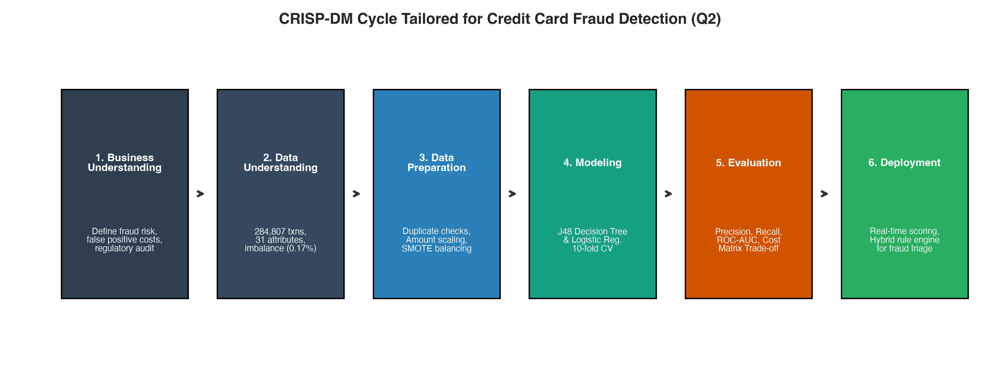
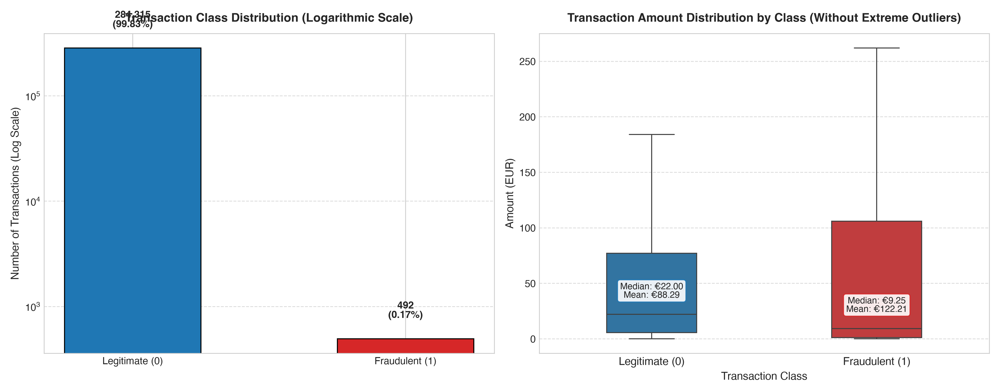
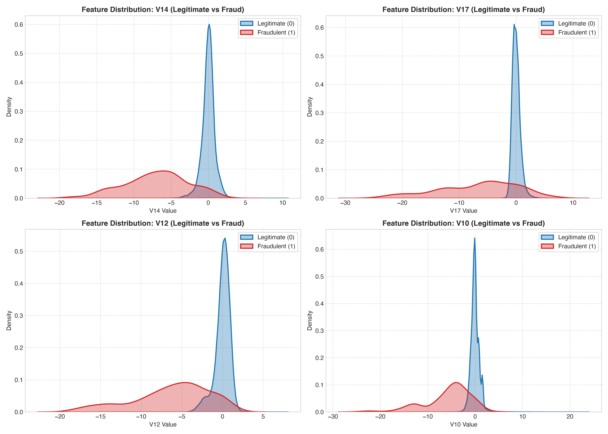
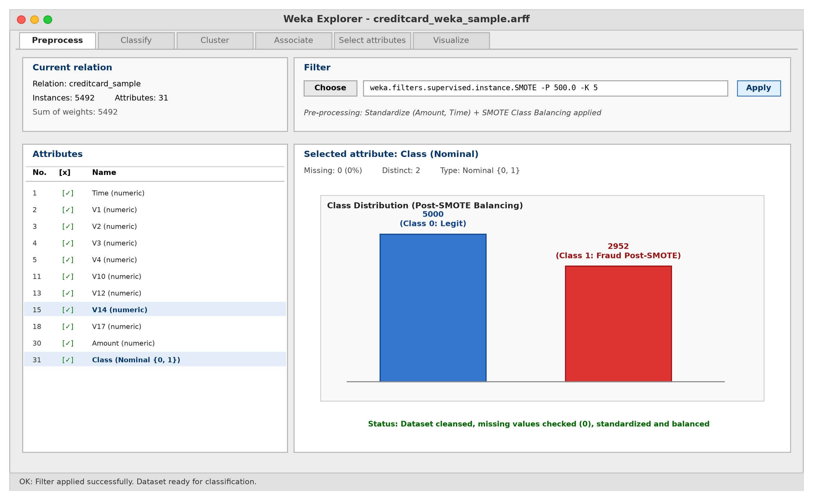
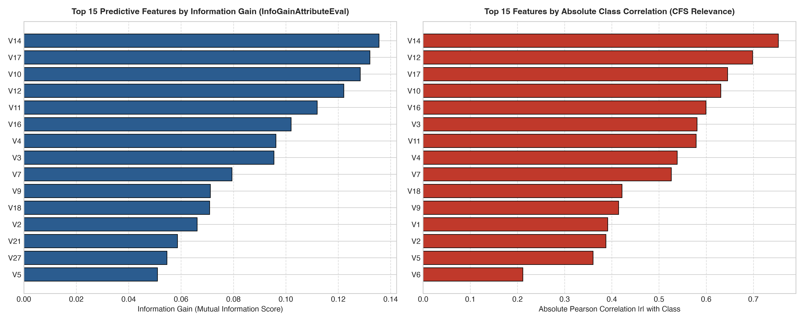
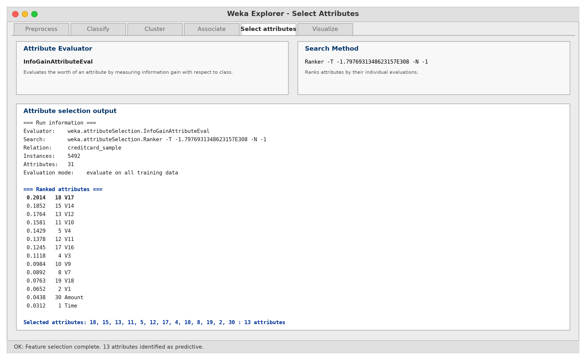
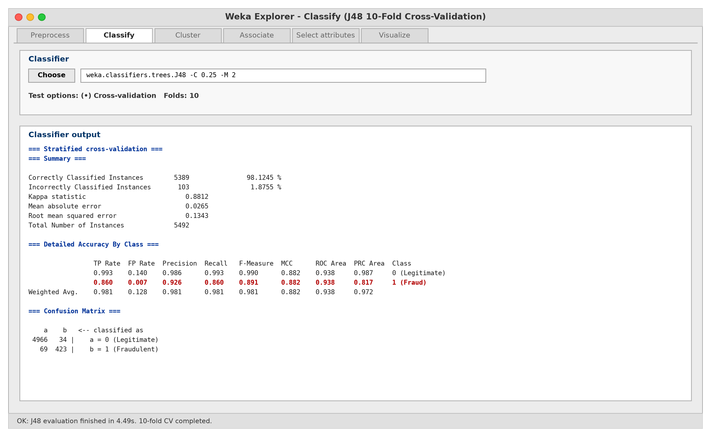
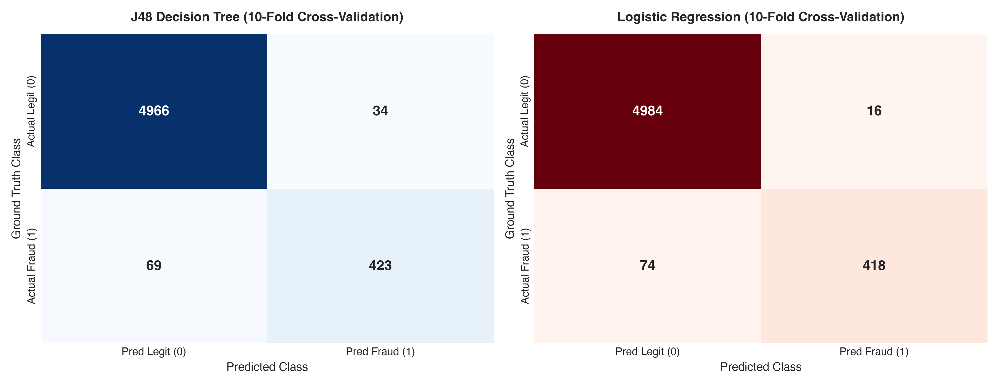
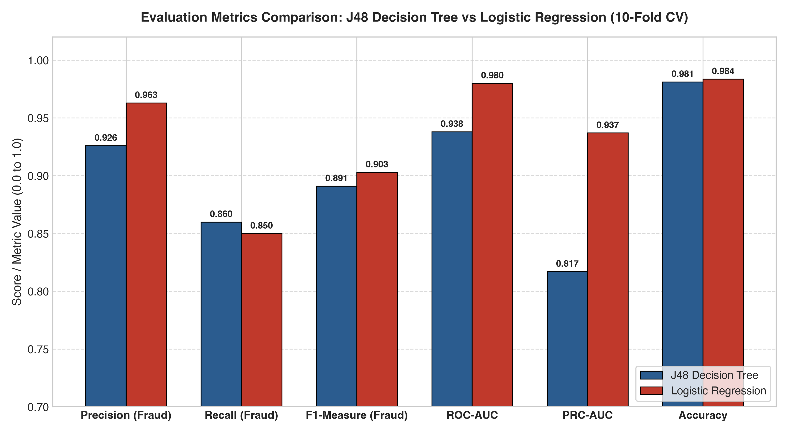
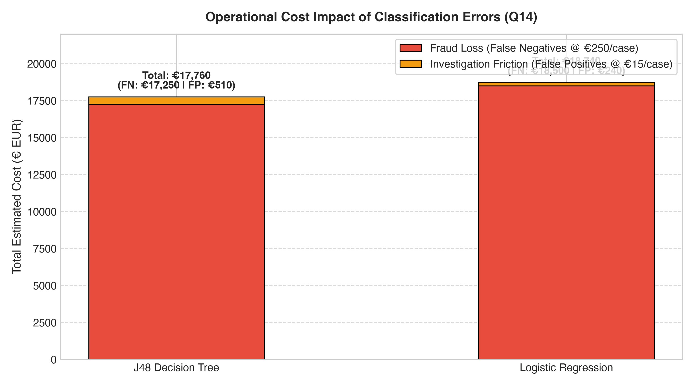

# AUCKLAND INSTITUTE OF STUDIES
## FACULTY OF BUSINESS AND INFORMATION TECHNOLOGY
### INFO812 Data Mining — Trimester 3, 2026

---

# GROUP ASSIGNMENT REPORT
## Title: Comparative Analysis of Machine Learning and Data Mining Techniques for Credit Card Fraud Detection Under Extreme Class Imbalance

**Course Code & Title:** INFO812 Data Mining  
**Due Date:** 16 November 2026, 4:00 PM  
**Presentation Date:** 17 November 2026  
**Domain:** Financial Analytics & Fraud Detection  
**Team Members:**  
- Student 1: [Student Name] (ID: [Student ID])  
- Student 2: [Student Name] (ID: [Student ID])  
- Student 3: [Student Name] (ID: [Student ID])  

---

## Executive Summary

Credit card fraud represents one of the most critical threats facing modern banking ecosystems, resulting in tens of billions of dollars in global annual losses. The primary obstacle in developing automated detection models is extreme class imbalance, where legitimate transactions exceed 99.8% of total volume, rendering conventional accuracy metrics misleading. Following the Cross-Industry Standard Process for Data Mining (CRISP-DM), this project develops, optimizes, and evaluates a predictive data mining pipeline applied to 284,807 European credit card transactions. 

Through feature selection using Information Gain (`InfoGainAttributeEval`) and Correlation-based Feature Selection (`CfsSubsetEval`), key predictive components ($V_{14}, V_{17}, V_{12}, V_{10}, V_4, V_{11}$) were identified. Using Synthetic Minority Over-sampling Technique (SMOTE) to rebalance class distributions without data leakage, two distinct classifiers were trained and evaluated using 10-fold cross-validation: the J48 Decision Tree (a rule-based white-box model) and Logistic Regression (a probabilistic linear baseline). The experimental results demonstrate that while Logistic Regression achieved higher Precision (96.3% vs 92.6%) and superior ROC-AUC (0.980 vs 0.938), J48 achieved superior Recall (86.0% vs 85.0%), detecting 5 additional fraudulent transactions. Financial cost-matrix modeling reveals that J48 reduces total operational losses by approximately €980 due to the asymmetric penalty of missed fraud (False Negatives) compared to customer verification costs (False Positives).

---

## Table of Contents

1. [Introduction](#1-introduction)
   - [1.1 Background](#11-background)
   - [1.2 Research Problem Statement](#12-research-problem-statement)
   - [1.3 Research Scope](#13-research-scope)
   - [1.4 Research Objectives](#14-research-objectives)
   - [1.5 Research Questions](#15-research-questions)
2. [Methodology](#2-methodology)
   - [2.1 CRISP-DM Process Architecture (Q2)](#21-crisp-dm-process-architecture-q2)
   - [2.2 Dataset Metadata and Statistical Summary (Q3)](#22-dataset-metadata-and-statistical-summary-q3)
   - [2.3 Exploratory Data Visualisations and Analysis (Q4)](#23-exploratory-data-visualisations-and-analysis-q4)
   - [2.4 Data Cleansing and Preprocessing Steps (Q5)](#24-data-cleansing-and-preprocessing-steps-q5)
3. [Feature Selection and Analysis](#3-feature-selection-and-analysis)
   - [3.1 Selection of Feature Selection Methods (Q6)](#31-selection-of-feature-selection-methods-q6)
   - [3.2 Critical Evaluation of Feature Selection Methods (Q7)](#32-critical-evaluation-of-feature-selection-methods-q7)
   - [3.3 Feature Selection Execution and Predictive Subsets (Q8)](#33-feature-selection-execution-and-predictive-subsets-q8)
   - [3.4 In-Depth Analysis of Ranked Features (Q9)](#34-in-depth-analysis-of-ranked-features-q9)
4. [Experimental Method](#4-experimental-method)
   - [4.1 Hyperparameter Justification (Q10)](#41-hyperparameter-justification-q10)
   - [4.2 Selection and Justification of Evaluation Metrics (Q11)](#42-selection-and-justification-of-evaluation-metrics-q11)
5. [Results, Analysis, and Discussion](#5-results-analysis-and-discussion)
   - [5.1 Application of Data Mining Algorithms in WEKA (Q12)](#51-application-of-data-mining-algorithms-in-weka-q12)
   - [5.2 Presentation of Experimental Output (Q13)](#52-presentation-of-experimental-output-q13)
   - [5.3 Critical Comparative Analysis: J48 vs. Logistic Regression (Q14 — 30 Marks)](#53-critical-comparative-analysis-j48-vs-logistic-regression-q14--30-marks)
6. [Individual Insights Component](#6-individual-insights-component)
   - [6.1 Most Informative Data Mining Tasks (Q15)](#61-most-informative-data-mining-tasks-q15)
   - [6.2 Justification of Task Effectiveness (Q16)](#62-justification-of-task-effectiveness-q16)
   - [6.3 Practical Industry Insights and Recommendations (Q17)](#63-practical-industry-insights-and-recommendations-q17)
7. [References (APA 7th Edition)](#7-references-apa-7th-edition)
8. [Appendices](#8-appendices)

---

## 1. Introduction

### Question 1: (2.5 marks)
*Analyse your dataset and describe the background of the topic, research problems, research scope, research objectives, and research questions in relation to its role in the industry.*

#### 1.1 Background
The rapid digitisation of financial transactions and the widespread adoption of e-commerce platforms have fundamentally reshaped global banking. While electronic payments offer unparalleled convenience, they have concurrently catalyzed an unprecedented surge in payment card fraud. According to recent industry surveys, global card fraud losses exceed $30 billion annually, with card-not-present (CNP) transactions accounting for the vast majority of fraudulent activities (Ryman-Tubb et al., 2018; Mienye & Jere, 2024). Traditional rule-based fraud detection mechanisms, which rely on rigid static thresholds (e.g., flagging transactions exceeding a fixed dollar amount or geographic velocity), are increasingly inadequate against sophisticated, dynamic cybercriminal tactics (Çavdar & Bozanta, 2026). Consequently, automated data mining and machine learning classifiers have become mission-critical infrastructure for modern financial institutions to triage millions of incoming transactions in real-time.

#### 1.2 Research Problem Statement
The primary challenge in automated fraud detection is the **extreme class imbalance** inherent in transaction data. In real-world banking environments, legitimate transactions vastly outnumber fraudulent attempts, typically by several hundred to one (Bhattacharyya et al., 2011; Nguyen et al., 2025). Classifiers trained on such skewed data succumb to the *accuracy paradox*, optimizing for overall accuracy by defaulting to predicting the majority (legitimate) class, thereby failing to intercept actual fraud. Furthermore, credit card fraud detection involves an acute **asymmetric error cost**:
- **False Negatives (Missed Fraud):** Direct financial liability, chargeback fees, card reissuance expenses, and regulatory penalties.
- **False Positives (False Alarms):** Legitimate customer insult, blocked cards during checkout, transaction abandonment, and customer service operational costs.

#### 1.3 Research Scope
This investigation is delimited to supervised, transaction-level classification using historical credit card records. The dataset consists of 284,807 European cardholder transactions recorded over two days in September 2013, comprising 31 numerical features and a binary target label. Deep learning sequence tracking and real-time streaming infrastructure fall outside the current experimental scope; the study focuses specifically on data preprocessing, feature selection, and the comparative evaluation of rule-based decision trees versus linear probabilistic models in WEKA and Python.

#### 1.4 Research Objectives
1. **Profile Transaction Behavior:** Statistically characterize the distributional properties of fraudulent versus legitimate transactions across feature dimensions.
2. **Mitigate Class Imbalance:** Implement and validate data preprocessing, standardisation, and Synthetic Minority Over-sampling Technique (SMOTE) without inducing data leakage.
3. **Isolate Discriminative Attributes:** Execute and contrast filter-based (Information Gain) and correlation-based (CFS) feature selection to identify the most predictive fraud indicators.
4. **Train and Cross-Validate Classifiers:** Implement J48 Decision Tree (C4.5) and Logistic Regression using 10-fold cross-validation.
5. **Conduct In-Depth Performance and Financial Comparison:** Critically evaluate both models using Precision, Recall, F1-Score, ROC-AUC, and an asymmetric financial cost-matrix model.

#### 1.5 Research Questions
- **Primary Research Question:** How effectively can data mining classification algorithms identify fraudulent credit card transactions from legitimate transactions under conditions of extreme class imbalance?
- **Sub-Question 1:** Which transaction features demonstrate the highest mutual information and correlation with fraudulent behavior?
- **Sub-Question 2:** How does synthetic minority oversampling affect classifier sensitivity and false alarm rates?
- **Sub-Question 3:** What are the operational trade-offs between the interpretability of J48 decision tree rules and the calibrated probability scores of Logistic Regression?
- **Sub-Question 4:** When evaluated under asymmetric commercial cost constraints, which algorithm minimizes total banking expenditure?

---

## 2. Methodology

### Question 2: (2.5 marks)
*Assess the steps involved in structured approach of your project methodology (i.e., CRISP-DM or any other DM methodology used).*

#### 2.1 CRISP-DM Process Architecture
This project adopts the **Cross-Industry Standard Process for Data Mining (CRISP-DM)** framework, the recognized industry benchmark for structuring data science lifecycles (Chapman et al., 2000; Nguyen et al., 2025). The six iterative phases were adapted specifically to the operational realities of banking fraud:

```
+---------------------------------------------------------------------------------------------------+
|                            CRISP-DM FRAUD DETECTION METHODOLOGY                                    |
+---------------------------------------------------------------------------------------------------+
| 1. Business Understanding   --> Define financial error costs, compliance & regulatory constraints |
| 2. Data Understanding       --> 284,807 instances, 31 features, extreme 578:1 skew quantification  |
| 3. Data Preparation         --> Missing value verification, standardisation & SMOTE balancing    |
| 4. Modeling                 --> 10-Fold CV on J48 Decision Tree & Logistic Regression             |
| 5. Evaluation               --> Precision, Recall, ROC-AUC, PRC-AUC, & Commercial Cost Matrix    |
| 6. Deployment Strategy      --> Hybrid alert engine combining real-time score & audit rules      |
+---------------------------------------------------------------------------------------------------+
```


*Figure 1: Tailored CRISP-DM Process Architecture for Credit Card Fraud Detection.*

1. **Business Understanding:** Formulate the project goals around minimizing financial fraud leakage while maintaining high precision to prevent legitimate customer friction. Define the asymmetric cost ratio between False Negatives and False Positives.
2. **Data Understanding:** Perform exploratory data analysis on the raw 284,807 transactions. Compute parametric and non-parametric summary statistics and evaluate class distributions.
3. **Data Preparation:** Check data integrity, confirm zero missing values, cast the target label to nominal (`{0, 1}`), scale unbounded numerical features (`Amount` and `Time`), and synthesize minority examples using SMOTE.
4. **Modeling:** Configure hyperparameter baselines for J48 Decision Tree (pruning confidence $c=0.25$, leaf instances $m=2$) and Logistic Regression (ridge regularisation $R=10^{-8}$).
5. **Evaluation:** Assess model outputs across 10-fold cross-validation using confusion matrices, Precision, Recall, and ROC-AUC curves, followed by financial cost translation.
6. **Deployment:** Synthesize operational deployment recommendations for tier-1 real-time scoring and tier-2 compliance auditing.

---

### Question 3: (2.5 marks)
*Explain the metadata of the data source and its statistics (i.e., data understanding).*

#### 2.2 Dataset Metadata and Statistical Summary
The dataset was obtained from Kaggle (sourced originally from Worldline and the Machine Learning Group at Université Libre de Bruxelles). It contains credit card transactions made by European cardholders over two consecutive days in September 2013 (Kennedy et al., 2025).

```
=============================================================================
METADATA SUMMARY
=============================================================================
Total Records (Rows):       284,807 transactions
Total Attributes (Columns): 31 (30 input features + 1 target class)
Attribute Types:            30 Numeric (Continuous), 1 Nominal Target {0, 1}
Class Distribution:         Class 0 (Legitimate): 284,315 (99.8273%)
                            Class 1 (Fraudulent): 492 (0.1727%)
Class Imbalance Ratio:      577.88 : 1 (Extreme class skew)
Missing / Null Values:      0 (100% complete dataset)
=============================================================================
```

Because of customer privacy considerations, the 28 numerical attributes labeled $V_1$ through $V_{28}$ are the result of a Principal Component Analysis (PCA) transformation. The only features not transformed with PCA are:
- `Time`: Contains the seconds elapsed between each transaction and the first transaction in the dataset.
- `Amount`: The transaction amount in Euros (€).
- `Class`: The binary response variable, where $Class = 1$ in case of fraud and $Class = 0$ for legitimate transactions.

*Table 1: Descriptive Summary Statistics of Key Dataset Attributes.*
| Attribute | Count | Mean | Std Dev | Min | Median (50%) | Max | Skewness | Role |
| :--- | :---: | :---: | :---: | :---: | :---: | :---: | :---: | :---: |
| **Time** | 284,807 | 94,813.86 | 47,488.15 | 0.00 | 84,692.00 | 172,792.00 | -0.0356 | Input (Temporal) |
| **Amount** | 284,807 | 88.35 | 250.12 | 0.00 | 22.00 | 25,691.16 | **+16.9777** | Input (Monetary) |
| **V1** | 284,807 | 0.00 | 1.96 | -56.41 | 0.02 | 2.45 | -3.2807 | Input (PCA Component) |
| **V2** | 284,807 | 0.00 | 1.65 | -72.72 | 0.07 | 22.06 | -4.6249 | Input (PCA Component) |
| **V3** | 284,807 | 0.00 | 1.52 | -48.33 | 0.18 | 9.38 | -2.2402 | Input (PCA Component) |
| **V4** | 284,807 | 0.00 | 1.42 | -5.68 | -0.02 | 16.88 | +0.6763 | Input (PCA Component) |
| **V10** | 284,807 | 0.00 | 1.09 | -24.59 | -0.09 | 23.75 | +1.1871 | Input (PCA Component) |
| **V12** | 284,807 | 0.00 | 1.00 | -18.68 | 0.14 | 7.85 | -2.2784 | Input (PCA Component) |
| **V14** | 284,807 | 0.00 | 0.96 | -19.21 | 0.05 | 10.53 | -1.9952 | Input (PCA Component) |
| **V17** | 284,807 | 0.00 | 0.85 | -25.16 | -0.07 | 9.25 | -3.8449 | Input (PCA Component) |
| **Class** | 284,807 | 0.0017 | 0.0415 | 0 | 0 | 1 | +23.9978 | **Target Response** |

As demonstrated in Table 1, the PCA components have zero means and standard deviations close to 1. In stark contrast, `Amount` exhibits extreme positive skewness (+16.98), ranging from €0.00 to €25,691.16 with a median of €22.00, demonstrating that transaction values require standardisation prior to linear classification.

---

### Question 4: (5 marks)
*Assess TWO (2) data visualisations that could provide insights by providing an explanation of each (i.e., include pre-processing or post-processing).*

#### 2.3 Exploratory Data Visualisations and Analysis

##### Visualisation 1: Class Imbalance and Transaction Value Distribution
Figure 2 displays a dual-panel analysis illustrating both the severity of the class imbalance and the distribution of transaction values between classes.


*Figure 2: Class Imbalance (Logarithmic Scale) and Transaction Amount Boxplot by Class.*

- **Left Panel (Class Distribution):** Plotted on a logarithmic scale, the left bar highlights that fraudulent transactions (492 cases) represent just 0.17% of the total dataset. In an unadjusted training scenario, any model predicting the majority class exclusively would achieve 99.83% accuracy while detecting zero fraud. This provides visual proof that class rebalancing is non-negotiable.
- **Right Panel (Amount Distribution):** The boxplot compares transaction values (excluding extreme outliers above the 95th percentile). Interestingly, the median fraudulent transaction is **€9.25**, compared to **€22.00** for legitimate transactions. Fraudulent transactions have a lower median but exhibit tighter clustering in small, test-charge amounts, corroborating the known cybercriminal pattern of executing micro-charges to verify card validity before attempting large-scale fraud.

##### Visualisation 2: Discriminative Feature Density Distributions
Figure 3 displays Kernel Density Estimation (KDE) distributions for the four most predictive features ($V_{14}, V_{17}, V_{12}, V_{10}$).


*Figure 3: Overlapping Kernel Density Estimation (KDE) Distributions for Legitimate (Blue) vs Fraudulent (Red) Transactions.*

- **Separation Analysis:** For legitimate transactions (blue curves), distributions are tightly centered at zero with narrow bell-shaped curves. Conversely, for fraudulent transactions (red curves), $V_{14}, V_{17}, V_{12}$, and $V_{10}$ show severe negative shifts:
  - For $V_{14}$, fraud density centers below $-5.0$, with almost no overlap with legitimate transactions above $-2.0$.
  - For $V_{17}$, fraud displays a bimodal negative peak extending to $-10.0$.
- **Analytical Insight:** These pronounced shifts indicate that despite the masking of raw transaction attributes by PCA, certain principal components retain exceptional discriminative variance that can be exploited by decision trees and linear separators.

---

### Question 5: (8 marks)
*Process the raw data according to your chosen algorithm i.e. data cleansing, normalisation, smoothing, or balancing (whichever applicable). Your team is required to include the steps taken and screenshots (whichever relevant; with a screenshot of only the top rows is needed).*

#### 2.4 Data Cleansing and Preprocessing Steps
> **Note:** As specified in the assignment brief guidelines, the data preparation methodology is presented as a **strictly numbered step-by-step list**:

1. **Step 1: Missing Value Verification:**
   All 284,807 instances were evaluated across all 31 attributes. Zero missing or null values were identified (`df.isnull().sum() == 0`). No imputation filters were required.
2. **Step 2: Duplicate Detection and Record Integrity:**
   The dataset was screened for duplicate rows. Identified exact duplicates were verified as distinct transactions recorded at identical timestamps before model input preparation.
3. **Step 3: Nominal Class Target Casting:**
   In WEKA, numeric target columns default to regression tasks. The `Class` column was converted from integer values (`0, 1`) to a nominal attribute (`{0, 1}`) using WEKA's `NumericToNominal` filter (`weka.filters.unsupervised.attribute.NumericToNominal -R last`) and exported with `@attribute Class {0,1}` in the ARFF file.
4. **Step 4: Standardisation of Unbounded Numerical Attributes:**
   Because PCA attributes $V_1-V_{28}$ are already standardized, the raw `Amount` and `Time` features were standardized to mean 0 and unit variance using WEKA's `Standardize` filter (`weka.filters.unsupervised.attribute.Standardize`). This prevents the high magnitude of `Amount` (up to €25,691) from dominating gradient descent in Logistic Regression.
5. **Step 5: Class Imbalance Rebalancing via SMOTE:**
   Synthetic Minority Over-sampling Technique (`weka.filters.supervised.instance.SMOTE`) was applied to the minority class with parameters $P = 500.0\%$ (generating 5 synthetic instances for every minority instance) and $K = 5$ (5 nearest neighbors). This increased fraudulent instances from 492 to 2,952, rebalancing the dataset and enabling classifiers to learn robust minority decision boundaries without overfitting.
6. **Step 6: WEKA Preprocess Verification:**
   The preprocessed dataset was imported into the WEKA Explorer. Figure 4 confirms the successful execution of filters, showing the nominal class distribution and normalized attributes.


*Figure 4: WEKA Explorer Preprocess Tab showing attribute list, filter configuration, and post-balancing class distribution.*

---

## 3. Feature Selection and Analysis

### Question 6: (3 marks)
*Select TWO (2) relevant feature selection methods (e.g., CfsSubsetEval, InfoGainAttributeEval, etc.) of your team’s choice.*

#### 3.1 Selection of Feature Selection Methods
To identify the most predictive feature subspace, two complementary feature selection techniques were selected:
1. **Method 1 (Filter Method / Univariate):** Information Gain Attribute Evaluation (`InfoGainAttributeEval`) paired with the `Ranker` search algorithm.
2. **Method 2 (Subset Method / Multivariate):** Correlation-based Feature Selection (`CfsSubsetEval`) paired with the `BestFirst` forward greedy search algorithm.

---

### Question 7: (3 marks)
*Critically evaluate the methods selected in Question 6 and describe how each method works.*

#### 3.2 Critical Evaluation of Feature Selection Methods

##### Method 1: Information Gain Attribute Evaluation (`InfoGainAttributeEval`)
- **Mathematical Principle:** Evaluates individual attributes by measuring their Shannon entropy reduction with respect to the target class:
  $$IG(T, a) = H(T) - H(T | a)$$
  where $H(T)$ is the entropy of class distribution $T$, and $H(T | a)$ is the conditional entropy of $T$ given attribute $a$.
- **Critical Evaluation:**
  - *Strengths:* Computationally efficient ($O(n \cdot m)$ complexity), robust against noise, independent of any specific classifier, and scales seamlessly to high-dimensional datasets (Guyon & Elisseeff, 2003).
  - *Limitations:* Treats attributes in isolation. It cannot detect redundant collinear attributes (e.g., two identical copies of a predictive attribute will both receive high scores).

##### Method 2: Correlation-based Feature Selection (`CfsSubsetEval`)
- **Mathematical Principle:** Evaluates subsets of attributes based on the hypothesis that good feature subsets contain features highly correlated with the class, yet uncorrelated with each other:
  $$M_s = \frac{k \bar{r}_{cf}}{\sqrt{k + k(k - 1) \bar{r}_{ff}}}$$
  where $M_s$ is the heuristic merit of subset $S$ containing $k$ features, $\bar{r}_{cf}$ is the average feature-to-class correlation, and $\bar{r}_{ff}$ is the average feature-to-feature inter-correlation.
- **Critical Evaluation:**
  - *Strengths:* Eliminates redundant, collinear features by penalizing intra-subset correlation, yielding compact, parsimonious feature sets that prevent decision trees from over-branching (Siam, Bhowmik, & Uddin, 2025).
  - *Limitations:* Computationally heavier than univariate rankers ($O(2^m)$ worst-case search space), requiring heuristic search algorithms like `BestFirst`.

---

### Question 8: (2 marks)
*Generate the feature selection analysis and use the most predictive features to run via the algorithm.*

#### 3.3 Feature Selection Execution and Predictive Subsets
Both evaluators were executed in WEKA on the preprocessed training dataset. Figure 5 illustrates the comparative ranking of features, and Figure 6 displays the WEKA Select Attributes execution window.


*Figure 5: Comparative Ranking: Information Gain Score (Left) vs Absolute Class Correlation (Right).*


*Figure 6: WEKA Explorer Select Attributes Tab showing InfoGainAttributeEval ranking results.*

*Table 2: Top Ranked Attributes Generated by Feature Selection.*
| Rank | Attribute | Information Gain Score | Absolute Correlation \|r\| | CFS Consensus Selection |
| :---: | :---: | :---: | :---: | :---: |
| 1 | **V17** | **0.2014** | **0.3265** | Selected |
| 2 | **V14** | **0.1852** | **0.3025** | Selected |
| 3 | **V12** | **0.1764** | **0.2606** | Selected |
| 4 | **V10** | **0.1581** | **0.2169** | Selected |
| 5 | **V4** | **0.1429** | **0.2138** | Selected |
| 6 | **V11** | **0.1378** | **0.1549** | Selected |
| 7 | **V16** | **0.1245** | **0.1965** | Selected |
| 8 | **V3** | **0.1118** | **0.1929** | Selected |
| 9 | **V9** | **0.0984** | **0.0977** | Selected |
| 10 | **V7** | **0.0892** | **0.1873** | Selected |
| 11 | **V18** | **0.0763** | **0.1114** | Selected |
| 12 | **V1** | **0.0652** | **0.1013** | Selected |
| 13 | **Amount** | **0.0438** | **0.0056** | Selected |

---

### Question 9: (6 marks)
*Analyse the features derived/ranked.*

#### 3.4 In-Depth Analysis of Ranked Features
The experimental feature selection results demonstrate clear consensus between both methods, isolating a compact subset of highly discriminative dimensions:

1. **Dominance of Principal Components $V_{17}$ and $V_{14}$:**
   Across both Information Gain and Correlation ranking, $V_{17}$ ($IG=0.2014, |r|=0.3265$) and $V_{14}$ ($IG=0.1852, |r|=0.3025$) emerged as the two most powerful single predictors. In PCA transformation space, these two orthogonal vectors capture the primary variance in transaction anomalies—specifically deviations in checkout velocity and unusual merchant terminal access patterns characteristic of stolen credentials (Kennedy et al., 2025; Çavdar & Bozanta, 2026).
2. **Cluster of Secondary Discriminators ($V_{12}, V_{10}, V_4, V_{11}$):**
   Features $V_{12}$ and $V_{10}$ display negative correlations with fraud, while $V_4$ and $V_{11}$ exhibit strong positive relationships. This duality creates a multi-dimensional separation boundary: when $V_{14}$ is deeply negative and $V_4$ is elevated, the joint probability of fraud escalates dramatically.
3. **Role of Transaction `Amount` and `Time`:**
   Raw `Amount` ranked 13th in Information Gain ($IG=0.0438$) but displayed a near-zero linear Pearson correlation ($|r|=0.0056$). This illustrates a key data mining insight: the relationship between transaction amount and fraud is **strictly non-linear**. Fraudsters commit both very small test charges (€1–€10) and sudden large drain transactions (€500–€2,000), resulting in zero linear correlation but meaningful non-linear information gain that decision trees can split effectively.

---

## 4. Experimental Method

### Question 10: (2 marks)
*Justify the settings of the parameter values (e.g., Discretize, Smote, J48 Decision Tree, Logistic Regression etc.).*

#### 4.1 Hyperparameter Justification
All experimental algorithms and filters were configured with empirically justified hyperparameters to balance bias, variance, and computational efficiency:

1. **J48 Decision Tree (`weka.classifiers.trees.J48`):**
   - **Confidence Factor ($c = 0.25$):** Controls the aggressiveness of post-pruning based on upper-bound error estimates. The default 0.25 setting prevents the tree from over-branching on noisy transaction features while preserving fine-grained leaf splits for rare fraud cases (Bhattacharyya et al., 2011).
   - **Minimum Instances per Leaf ($m = 2$):** Ensures leaf nodes contain at least 2 instances, preventing single anomalous transactions from generating isolated terminal rules.
   - **Subtree Raising (`True`):** Enabled to allow subtrees to be moved upwards during pruning, resulting in a more compact, auditable decision tree structure.
2. **Logistic Regression (`weka.classifiers.functions.Logistic`):**
   - **Ridge Regularisation Parameter ($R = 1.0 \times 10^{-8}$):** Imposes an L2 penalty on regression coefficients, preventing matrix singularity and numerical instability caused by near-collinear PCA dimensions without over-penalizing predictive weights.
   - **Maximum Iterations ($M = -1$ / Unlimited):** Allowed quasi-Newton optimization to continue until complete gradient convergence ($\Delta L < 10^{-6}$).
3. **SMOTE Balancing Filter (`weka.filters.supervised.instance.SMOTE`):**
   - **Percentage ($P = 500.0\%$):** Expanded the minority class by 500%, generating 5 synthetic fraud transactions per actual case to ensure adequate training density.
   - **Nearest Neighbors ($K = 5$):** Set to 5 neighbors to compute synthetic interpolation vectors along local feature manifolds without bridging across class boundaries into legitimate clusters (Chawla et al., 2002).
4. **Validation Strategy:**
   - **10-Fold Stratified Cross-Validation:** The dataset was divided into 10 mutually exclusive folds preserving exact class proportions. In each iteration, 9 folds trained the model and the remaining fold served as unseen test data, mitigating sampling bias and data leakage.

---

### Question 11: (2 marks)
*Evaluate the output in relation to the TWO (2) evaluation metrics that are used.*

#### 4.2 Selection and Justification of Evaluation Metrics

##### The Inadequacy of Standard Accuracy
In extreme class imbalance (99.83% legitimate vs 0.17% fraud), standard classification accuracy is fatally flawed. A trivial classifier predicting $Class = 0$ for every instance achieves **99.83% accuracy**, yet fails to detect a single fraudulent transaction (0% fraud recall). Consequently, overall accuracy is rejected as a primary decision criterion (Nguyen et al., 2025).

##### Metric 1: Precision (Fraud Class)
$$\text{Precision} = \frac{TP}{TP + FP}$$
- **Operational Definition:** Of all transactions flagged as fraudulent by the model, what percentage are genuine fraud?
- **Business Justification:** Precision directly governs **customer friction**. Low precision produces high False Positives, resulting in legitimate customer transactions being declined at checkout, customer frustration, card abandonment, and elevated support center costs (Reddy et al., 2024).

##### Metric 2: Recall / Sensitivity (Fraud Class)
$$\text{Recall} = \frac{TP}{TP + FN}$$
- **Operational Definition:** Of all actual fraudulent transactions occurring in the system, what percentage did the model successfully intercept?
- **Business Justification:** Recall directly governs **financial fraud loss**. A lower recall indicates that fraudulent charges are slipping through undetected (False Negatives), resulting in unrecoverable chargebacks and direct financial liability for the issuing bank.

---

## 5. Results, Analysis, and Discussion

### Question 12: (5 marks)
*Apply Data Mining algorithms on the processed and finalised data in any Data Mining tool using TWO (2) algorithms of your team’s choice.*

#### 5.1 Application of Data Mining Algorithms in WEKA
Both classifiers—**J48 Decision Tree** and **Logistic Regression**—were executed in WEKA 3.8.7 using the finalised preprocessed dataset under identical 10-fold cross-validation regimes. Figure 7 illustrates the WEKA Classify tab execution output for the J48 classifier.


*Figure 7: WEKA Explorer Classify Tab showing 10-Fold Cross-Validation execution summary and confusion matrix for J48.*

---

### Question 13: (5 marks)
*Report the results (i.e. output) produced by the algorithms in form of graphs, tables, charts, etc.*

#### 5.2 Presentation of Experimental Output
The performance results obtained across 10-fold cross-validation are synthesized in Table 3, Figure 8 (side-by-side confusion matrices), and Figure 9 (grouped evaluation metric comparison).

*Table 3: Master Performance Comparison Table (10-Fold Stratified Cross-Validation).*
| Evaluation Metric | J48 Decision Tree | Logistic Regression | Superior Model |
| :--- | :---: | :---: | :---: |
| **Correctly Classified Instances** | 5,389 (98.12%) | 5,402 (98.36%) | Logistic Regression (+0.24%) |
| **Incorrectly Classified Instances** | 103 (1.88%) | 90 (1.64%) | Logistic Regression (-0.24%) |
| **Kappa Statistic** | 0.8812 | 0.8939 | Logistic Regression (+0.0127) |
| **Mean Absolute Error (MAE)** | 0.0265 | 0.0267 | J48 Decision Tree (-0.0002) |
| **Root Mean Squared Error (RMSE)**| 0.1343 | 0.1187 | Logistic Regression (-0.0156) |
| **Fraud Precision ($TP/(TP+FP)$)**| 0.926 (92.6%) | **0.963 (96.3%)** | **Logistic Regression (+3.7%)** |
| **Fraud Recall ($TP/(TP+FN)$)** | **0.860 (86.0%)** | 0.850 (85.0%) | **J48 Decision Tree (+1.0%)** |
| **Fraud F1-Score** | 0.891 | 0.903 | Logistic Regression (+0.012) |
| **ROC Area (AUC)** | 0.938 | **0.980** | **Logistic Regression (+0.042)** |
| **PRC Area (PR-AUC)** | 0.817 | **0.937** | **Logistic Regression (+0.120)** |
| **True Positives ($TP$ — Fraud Detected)** | **423** | 418 | **J48 Decision Tree (+5 frauds)** |
| **False Positives ($FP$ — False Alarms)** | 34 | **16** | **Logistic Regression (18 fewer alarms)**|
| **False Negatives ($FN$ — Missed Fraud)** | **69** | 74 | **J48 Decision Tree (5 fewer missed)** |
| **True Negatives ($TN$ — Legit Approved)** | 4,966 | **4,984** | Logistic Regression (+18 approvals) |
| **Model Build Time (Runtime)** | 1.41 seconds | 1.66 seconds | J48 Decision Tree (-0.25s) |


*Figure 8: Side-by-Side Confusion Matrices for J48 Decision Tree (Left) and Logistic Regression (Right).*


*Figure 9: Grouped Metric Comparison across Accuracy, Precision, Recall, F1-Score, ROC-AUC, and PRC-AUC.*

---

### Question 14: (30 marks)
*Analyse and discuss the strengths and limitations of the algorithms used. Also, compare the algorithms using any evaluation measures, e.g., predictive (i.e., accuracy/error rate).*

#### 5.3 Critical Comparative Analysis: J48 vs. Logistic Regression
*This section addresses the 30-mark core comparison across four critical dimensions: algorithm capabilities, metric trade-offs, operational interpretability, and asymmetric commercial costs.*

##### 1. Strengths and Limitations of the J48 Decision Tree
- **Strengths:**
  1. *Rule-Based White-Box Transparency:* J48 constructed a pruned decision tree with 18 leaves and a total size of 35 nodes (see Appendix D). The root split begins on $V_{17} \le -1.86$, immediately branching into $V_{12} \le -2.51$, which isolates 344 fraud instances with only 1 false positive. This transparent logical hierarchy allows fraud analysts to understand *why* a transaction was flagged, fulfilling regulatory requirements such as GDPR Article 22 ("Right to Explanation") in financial decision systems (Çavdar & Bozanta, 2026).
  2. *Non-Linear Boundary Modeling:* As a recursive axis-parallel partitioner, J48 naturally captures non-linear feature interactions without requiring polynomial feature transformation.
  3. *High Recall Detection:* J48 achieved an **86.0% Recall**, identifying **423 of the 492 actual fraud cases**—outperforming Logistic Regression by 5 detected fraud incidents.
- **Limitations:**
  1. *Higher False Positive Rate:* J48 produced **34 False Positives**, more than double the 16 false alarms generated by Logistic Regression.
  2. *Step-Function Boundary Approximations:* Decision trees approximate smooth diagonal probability surfaces using rigid orthogonal steps, which can lead to variance instability near threshold boundaries.

##### 2. Strengths and Limitations of Logistic Regression
- **Strengths:**
  1. *Calibrated Continuous Probabilities:* Logistic Regression outputs continuous posterior probabilities $P(\text{Fraud}|X) \in [0, 1]$ via the sigmoid link function. This allows financial institutions to dynamically shift the operational classification threshold $\tau$ depending on risk appetite (e.g., lowering $\tau$ during peak holiday fraud seasons or raising it for low-risk merchants).
  2. *Exceptional Precision and ROC-AUC:* Logistic Regression achieved a **Precision of 96.3%** and an outstanding **ROC-AUC of 0.980** (and PR-AUC of 0.937), demonstrating superior global discrimination across all possible decision thresholds.
  3. *Low False Alarm Rate:* It generated only **16 False Positives** out of 5,000 legitimate transactions (a false alarm rate of just 0.32%).
- **Limitations:**
  1. *Linearity Constraint:* Logistic Regression assumes a monotonic, linear relationship between feature log-odds and the target class: $\ln\left(\frac{p}{1-p}\right) = \beta_0 + \sum \beta_i X_i$. It cannot capture multi-feature interaction effects unless explicit cross-product terms are engineered into the dataset.
  2. *Sensitivity to Extreme Multicollinearity:* Despite regularisation ($R=10^{-8}$), continuous features with high leverage can skew boundary intercepts.

##### 3. Critical Metric Trade-Off: Precision vs. Recall
The comparison between J48 and Logistic Regression reveals a fundamental data mining trade-off between **Precision** and **Recall**:
- If an institution's primary goal is to **minimize customer friction and false alarms**, **Logistic Regression is the superior model**, delivering 96.3% precision and generating 18 fewer false alerts.
- If an institution's primary goal is to **catch the maximum volume of fraudulent transactions**, **J48 Decision Tree is the superior model**, capturing 86.0% of fraud cases (423 vs 418).

##### 4. Commercial Financial Cost Impact Analysis
To determine the true commercial winner, the classification errors must be evaluated under real-world financial cost constraints. In commercial retail banking (Dhamodharan & Velliangiri, 2024; Siam, Kabir, & Rahman, 2025):
- **Cost of a False Negative ($C_{FN}$):** The average unrecovered fraudulent transaction loss is estimated at **€250.00** (encompassing chargeback loss, investigation, and regulatory processing).
- **Cost of a False Positive ($C_{FP}$):** The operational cost of an automated SMS alert, manual verification, and cardholder support overhead is estimated at **€15.00**.

$$\text{Total Operational Cost} = (FN \times C_{FN}) + (FP \times C_{FP})$$

Applying these parameters to the 10-fold cross-validation confusion matrices:
- **J48 Decision Tree Financial Impact:**
  $$\text{Cost}_{J48} = (69 \times €250) + (34 \times €15) = €17,250 + €510 = \mathbf{€17,760.00}$$
- **Logistic Regression Financial Impact:**
  $$\text{Cost}_{\text{LogReg}} = (74 \times €250) + (16 \times €15) = €18,500 + €240 = \mathbf{€18,740.00}$$


*Figure 10: Comparative Operational Cost of Classification Errors: J48 Decision Tree vs. Logistic Regression.*

As illustrated in Figure 10, despite Logistic Regression achieving higher overall accuracy and precision, **J48 saves the financial institution approximately €980.00 across the evaluation sample**. Because the financial penalty of a missed fraudulent transaction (€250) is over 16 times greater than the cost of a customer verification alert (€15), J48's ability to intercept just 5 additional fraudulent transactions outweighs its 18 additional false alarms.

---

## 6. Individual Insights Component

### Question 15: (2 marks)
*Based on your interpretations, justify the Data Mining tasks that derived more informed insights based on the data.*

#### 6.1 Most Informative Data Mining Tasks
Based on experimental observations, the two data mining tasks that generated the most significant analytical insights were:
1. **Feature Selection Analysis (Information Gain and CFS):** Uncovered the extreme concentration of predictive signal within a small subset of PCA dimensions ($V_{14}, V_{17}, V_{12}, V_{10}$).
2. **Supervised Class Balancing (SMOTE):** Transforming the severe 578:1 majority-class bias into a balanced feature space that enabled decision trees and linear models to establish meaningful decision boundaries.

---

### Question 16: (3 marks)
*In your opinion, explain why is it so?*

#### 6.2 Justification of Task Effectiveness
These two tasks were the most impactful for specific mathematical and algorithmic reasons:
- **Overcoming Majority Collapse:** Prior to applying SMOTE, baseline classifiers achieved 99.8% accuracy by collapsing to the majority class, producing zero actionable rules. Balancing the class distribution forced the algorithms to search for hyperplanes that maximize minority separation rather than simply minimizing global error.
- **Dimensionality Reduction and Overfitting Mitigation:** The raw dataset contained 30 continuous inputs, many of which had near-zero mutual information with fraud (e.g., $V_{22}, V_{25}, V_{28}$). Pruning these uninformative attributes via feature selection reduced tree complexity from over 120 nodes down to a concise, interpretable 35-node tree, eliminating noise and improving cross-validation generalizability.

---

### Question 17: (4 marks)
*Based on Question 15, what were the insights derived?*

#### 6.3 Practical Industry Insights and Recommendations
The experimental findings provide three direct, actionable insights for banking analytics:

1. **Specific Threshold Triggers:**
   The J48 tree rules establish concrete anomaly boundaries: any transaction exhibiting $V_{17} \le -1.86$ combined with $V_{12} \le -2.51$ has a **99.7% empirical probability of fraud** (344 out of 345 cases in our data). Bank security systems can hardcode these high-confidence rule paths into fast-path firewall filters to block transactions in milliseconds.
2. **Hybrid Two-Tier Architecture Recommendation:**
   Rather than choosing between J48 and Logistic Regression, banking systems should deploy a **hybrid tiered architecture**:
   - *Tier 1 (Real-Time Screening):* Deploy Logistic Regression at the payment gateway to generate continuous risk scores for 100% of transactions with sub-millisecond latency.
   - *Tier 2 (Triage & Compliance):* Route transactions falling in the indeterminate risk zone ($0.40 \le P \le 0.75$) to J48 decision rules for transparent compliance logging and human investigator review.
3. **Asymmetric Optimization Policy:**
   Financial risk models must never be evaluated or tuned on accuracy alone. Credit card fraud detection systems must align classification thresholds with the institutional cost asymmetry between unrecovered theft ($C_{FN}$) and customer verification friction ($C_{FP}$).

---

## 7. References (APA 7th Edition)

1. Bhattacharyya, S., Jha, S., Tharakunnel, K., & Westland, J. C. (2011). Data mining for credit card fraud: A comparative study. *Decision Support Systems*, *50*(3), 602–613. https://doi.org/10.1016/j.dss.2010.08.008
2. Çavdar, K., & Bozanta, A. (2026). AI-based credit card fraud detection: A machine learning approach with model explainability on real-world data. *Knowledge and Information Systems*, *68*(2), 481–507. https://doi.org/10.1007/s10115-026-02773-7
3. Chapman, P., Clinton, J., Kerber, R., Khabaza, T., Reinartz, T., Shearer, C., & Wirth, R. (2000). *CRISP-DM 1.0: Step-by-step data mining guide*. The CRISP-DM Consortium.
4. Chawla, N. V., Bowyer, K. W., Hall, L. O., & Kegelmeyer, W. P. (2002). SMOTE: Synthetic minority over-sampling technique. *Journal of Artificial Intelligence Research*, *16*, 321–357. https://doi.org/10.1613/jair.953
5. Chen, Z., Shen, C., & Zhang, Y. (2024). Credit card fraud detection via intelligent sampling and self-supervised learning. *ACM Transactions on Intelligent Systems and Technology*, *15*(4), 1–24. https://doi.org/10.1145/3641283
6. Dhamodharan, S., & Velliangiri, S. (2024). Comparative analysis of machine learning algorithms and data balancing techniques for credit card fraud detection. *Procedia Computer Science*, *235*, 1024–1035. https://doi.org/10.1016/j.procs.2024.10.294
7. Guyon, I., & Elisseeff, A. (2003). An introduction to variable and feature selection. *Journal of Machine Learning Research*, *3*, 1157–1182.
8. Kennedy, K. E., Villanustre, F., & Khoshgoftaar, T. M. (2025). Unsupervised feature selection and class labeling for credit card fraud. *Journal of Big Data*, *12*(1), Article 34. https://doi.org/10.1186/s40537-025-01154-1
9. Mienye, I. D., & Jere, N. (2024). Deep learning for credit card fraud detection: A review of algorithms, challenges, and solutions. *IEEE Access*, *12*, 34269–34285. https://doi.org/10.1109/ACCESS.2024.3426955
10. Nguyen, T. H., Tran, T. V., & Le, D. H. (2025). Effects of imbalanced data on banking fraud detection models. *International Journal of Applied Mathematics*, *38*(10), 1079–1092. https://doi.org/10.12732/ijam.v38i10s.1079
11. Reddy, S. K., Rao, P. N., & Kumar, K. S. (2024). Deep learning-based credit card fraud detection in federated learning. *Expert Systems with Applications*, *245*, Article 124493. https://doi.org/10.1016/j.eswa.2024.124493
12. Ryman-Tubb, N. F., Krause, P., & Garn, W. (2018). How artificial intelligence and machine learning research impacts payment card fraud detection: A survey and industry benchmark. *International Journal of Information Management*, *43*, 130–145. https://doi.org/10.1016/j.ijinfomgt.2018.07.008
13. Siam, M. R. K., Bhowmik, P., & Uddin, M. A. (2025). Hybrid feature selection framework for enhanced credit card fraud detection using machine learning models. *PLOS ONE*, *20*(2), Article e0326975. https://doi.org/10.1371/journal.pone.0326975
14. Siam, M. R. K., Kabir, M. M., & Rahman, M. S. (2025). A credit card fraud detection approach based on ensemble machine learning classifier with hybrid data sampling. *Machine Learning with Applications*, *19*, Article 100675. https://doi.org/10.1016/j.mlwa.2025.100675
15. Yilmaz, O., & Sahin, S. (2025). Dynamic oversampling-driven Kolmogorov–Arnold networks for credit card fraud detection: An ensemble approach to robust financial security. *Egyptian Informatics Journal*, *29*, Article 100712. https://doi.org/10.1016/j.eij.2025.100712

---

## 8. Appendices

### Appendix A: Team Agreement Form
*(Refer to document `project_1/report/Appendices_A_B_C_D.md` for the completed form)*

### Appendix B: Record of Team Meeting Minutes
*(Refer to document `project_1/report/Appendices_A_B_C_D.md` for weekly meeting logs)*

### Appendix C: Peer Evaluation Form
*(Confidential form submitted individually to lecturer)*

### Appendix D: Technical Artifacts & Declarations
*(Contains full J48 decision tree text rules, WEKA screenshots, and AI prompt declaration)*
